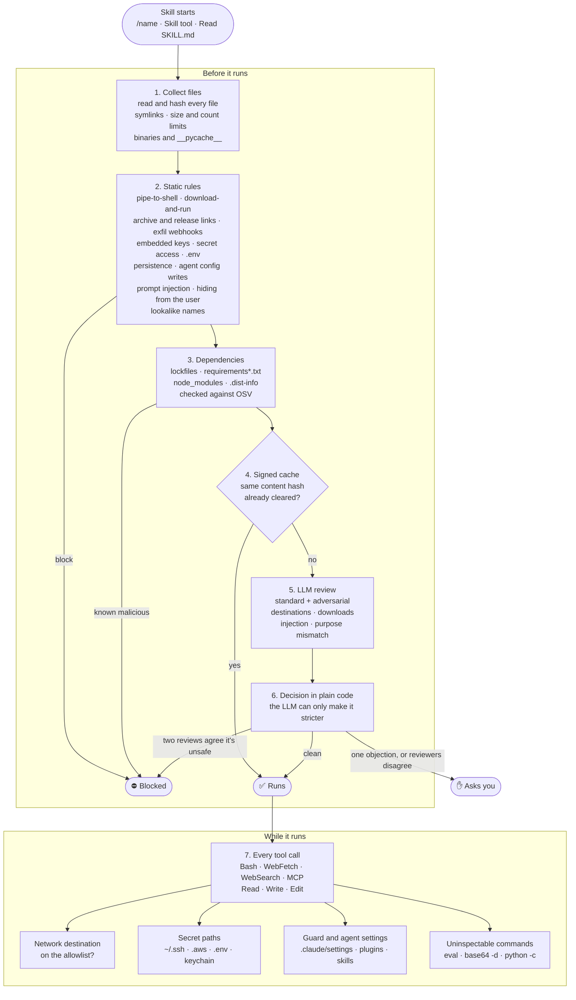

# skill-guard

A skill is someone else's instructions and code, running with your permissions. skill-guard is a Claude Code plugin that reviews each skill before it runs and limits what it can reach while it runs.

It checks a skill however it starts: a typed `/name`, the `Skill` tool, or Claude reading a `SKILL.md` directly.

## Install

Requires Python 3.11+ and at least one reviewer: the `claude` CLI, the `codex` CLI, or `ANTHROPIC_API_KEY`.

Try it in one session:

```bash
claude --plugin-dir /path/to/skill-guard
```

## What gets checked



Any error blocks. Secret paths and guard settings are protected in every session, not only while a skill is running.

### Static rules

These run first. A static block can't be overridden by an LLM, the cache, or an approval.

| Blocks | Asks you |
| --- | --- |
| `curl … \| sh`, decode-and-run, "download and run" | `eval`, `exec`, `os.system` |
| Links to archives, binaries, GitHub Releases | `curl`, `wget`, `ssh` and network libraries |
| Archive passwords, "required helper tool" prerequisites | Installing packages at runtime |
| Telling the user to paste something into their terminal | `rm -rf`, `sudo`, `chmod 777` |
| Webhook and capture endpoints (Discord, Slack, ngrok, …) | Symlinks and media files |
| Embedded API keys and tokens | |
| Reading `~/.ssh`, `.aws/credentials`, `.env`, keychains | |
| Writing shell rc files, cron, launch agents, git hooks | |
| Changing agent settings, memory, or skills | |
| "Ignore previous instructions", text aimed at the reviewer | |
| Telling the agent to hide things from the user | |
| Names one or two letters off a trusted skill (`skil-creator`) | |
| Unreadable binaries, `__pycache__`, files over the size limit | |

The full list is in [config/rules.json](config/rules.json).

### LLM review

Two reviews run: a standard one and an adversarial one. By default the reviewer is Claude; if Claude isn't installed it's Codex, and otherwise the Anthropic API.

Reviewer output is treated as facts, and plain code makes the decision. Blocking takes two independent reviews that agree. A single objection, or reviewers that disagree, stops the skill and asks you instead.

### Cache

Clean results are signed and cached by content hash for 30 days. Any edit to any file forces a new review. Dependency advisories are checked before the cache, so a new advisory still reaches skills that already passed.

## When a skill is stopped

Claude Code shows the findings as a prompt, or as a block for skills started with a typed `/name`. To approve that exact version, run this in your own terminal:

```bash
python3 -I guard/cli.py approve <skill>
```

Approval has to happen in a real terminal. Claude can't approve a skill for you.

Inside Claude Code you can also run:

- `/skill-guard status` to see the current configuration and reviewer.
- `/skill-guard scan <path>` to review a skill before you install it.

## Configuration

Copy `config/config.example.toml` to `~/.claude/skill-guard/config.toml` and keep only the lines you change. For example, to use two different models as reviewers:

```toml
reviewers = ["claude-cli", "codex-cli"]
```

| Setting | Default | What it does |
| --- | --- | --- |
| `mode` | `"enforce"` | `"audit"` logs decisions without blocking, for tuning |
| `reviewers` | `"auto"` | Which reviewers to use |
| `allow_self_approval` | `true` | Allow `approve` from your own terminal |
| `dependency_check` | `true` | Check packages against OSV |
| `cache_ttl_days` | `30` | How long a clean result lasts |
| `allowlist` | Anthropic docs, `localhost`, … | Hosts a running skill may reach |

Lists replace the defaults rather than add to them, so copy the defaults from [config/policy.default.json](config/policy.default.json) before adding your own entries.

An org file at `/Library/Application Support/ClaudeCode/skill-guard.toml` (macOS) or `/etc/claude-code/skill-guard.toml` (Linux) overrides the user file. Unknown settings or invalid values block every skill until they're fixed, so a typo can't weaken the guard.

## What leaves your machine

- **Skill contents** go to the reviewer you chose: Claude, Codex, or the Anthropic API.
- **Package names and versions** go to [OSV](https://osv.dev). Nothing else is sent.

## Limits

- The hook checks are not a network boundary. Turn on the Claude Code sandbox as well.
- Opening a skill with `cat` through Bash is not treated as starting it.
- Attacks through allowed services, or harmful changes that make no network call, can still get through.
- A Codex reviewer runs read-only but can't have its tools fully removed.
- It errs on the side of blocking, so expect false positives. Safe skills can be stopped when they edit agent config as their real job, quote attack patterns in their docs, or mention example hosts and IPs. In our [analysis](analysis/bad-skills-analysis.md), it stopped all 15 malicious skills and also blocked 17 of 40 legitimate ones. Use `mode = "audit"` to see what would be blocked before enforcing.

## Tests

```bash
python3 -m unittest tests/test_guard.py
```
